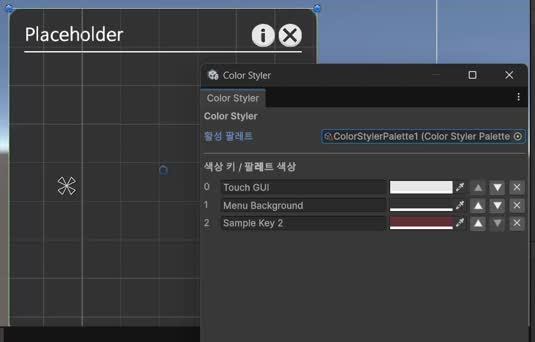
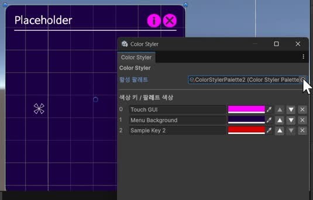
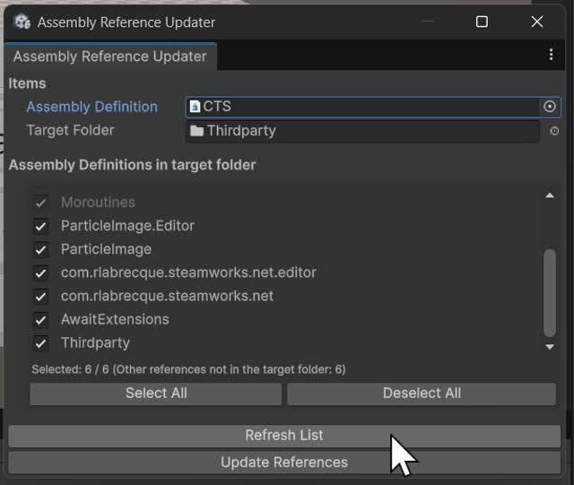

# 여러 프로젝트의 개발 도구

콘텐츠 편집, 반복 설정과 실행 확인에 필요한 작업을 인스펙터와 EditorWindow로 옮겼습니다.

## Traveler’s Choice · Color Styler

여러 UI에서 같은 역할의 색을 유지하고 다른 색 조합을 비교하기 위해 색상 키와 팔레트를 분리했습니다.

| 팔레트 변경 전 | 다른 팔레트 적용 |
|---|---|
|  |  |

| 구성 | 역할 |
|---|---|
| Manager | 색상 키와 현재 팔레트 관리 |
| Palette | 키에 대응하는 실제 색 값 보관 |
| StyledImage | 자신의 키에 맞는 색 적용과 변경 알림 구독 |
| EditorWindow | 팔레트 편집과 적용 결과 비교 |

팔레트나 색을 바꾸면 연결된 UI가 갱신됩니다. 키 이름을 바꿀 때는 열린 씬의 StyledImage와 관련 프리팹 참조도 갱신합니다.

키별 참조 캐시를 두고, 프리팹 YAML의 스크립트 GUID로 대상을 좁혔습니다. 씬 열기·닫기와 어셈블리 재로드 때 캐시를 무효화하며, 수정 경로에 Undo와 저장 처리를 넣었습니다. 닫힌 씬의 일괄 변환은 지원하지 않습니다.

GitHub Copilot의 줄 단위 제안을 활용했습니다. 런타임 팔레트 교체 경로를 마련했으며 플레이어용 테마 선택 메뉴는 미구현입니다.

## CTS · 어셈블리 참조 편집기

폴더 안의 asmdef를 검색하고 선택한 참조를 대상 어셈블리에 일괄 반영하는 EditorWindow를 만들었습니다.

대상 폴더 밖의 GUID 참조는 유지하고, 선택한 참조를 합쳐 중복을 제거했습니다. Unity AI Assistant의 도움을 받아 작성했으며 GUID 기반 참조를 다룹니다.

## BuilderRPG · 상호작용 슬롯 인스펙터

슬롯 목록과 이름·설명·아이콘·레벨을 편집하고, 유형에 따라 애니메이션·대기시간·이벤트를 표시하는 커스텀 인스펙터를 만들었습니다.

2023년 8월의 Task 슬롯 편집 화면입니다. 현재는 관련 필드 변경으로 이 인스펙터가 비활성화되어 있습니다.

## 반복 실행과 참조 확인

| 도구 | 기능 |
|---|---|
| Traveler’s Choice·CTS · 시작 씬 선택기 | 현재 편집 씬과 별도로 Play 시작 씬 지정. 설정은 EditorPrefs에 보관 |
| Traveler’s Choice · Asset ID Viewer | 선택한 에셋의 이름·경로·GUID·Local File Identifier 표시 |
| BuilderRPG · 지형 생성 인스펙터 | 시드·크기·육지 비율·강 수, 진행률과 취소·재시작 관리 |
| BuilderRPG · Terrain Snap | 묻힌 배치물 검사와 오브젝트 밑면 기준 스냅 |

Terrain Snap은 2026년 AI와 진행한 후기 정비에 해당합니다.

## 관련 기록

- [BuilderRPG 상호작용과 편집 경로](https://github.com/TcDRair/BuilderRPG/blob/ff4592bf830bcffe0cffec7a73430ea75390d08b/docs/03-상호작용-작업큐.md)
- [Terrain Snap 추가 기록](https://github.com/TcDRair/BuilderRPG/commit/91e0e79d3765d7e81a73dabe0c5d1b1d85e0e8e4)

[포트폴리오로 돌아가기](../README.md)
