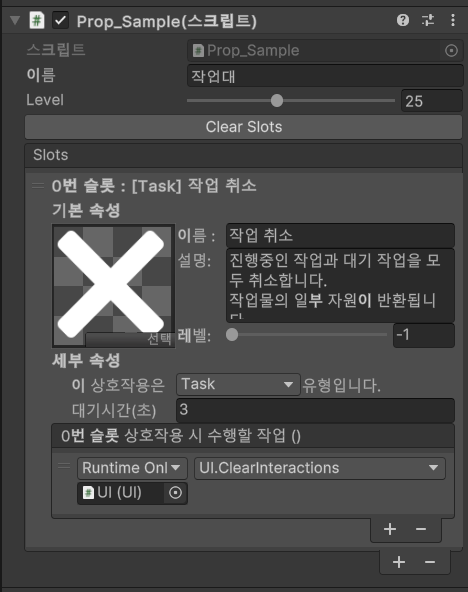

# 여러 프로젝트에서 만든 개발 도구

게임 기능을 만들면서 반복되는 편집과 확인 작업도 도구로 옮겼습니다. BuilderRPG에서는 지형 생성과 상호작용 편집을, Traveler’s Choice에서는 UI 색상과 에셋 확인을, Traveler’s Choice·CTS에서는 테스트를 시작할 씬 선택을 다뤘습니다.

## BuilderRPG · 상호작용 슬롯을 편집하는 인스펙터

2023년 작업 기록에 상호작용 슬롯용 커스텀 인스펙터가 남아 있습니다. 슬롯 목록을 편집하고 이름·설명·아이콘·레벨을 지정하며, 선택한 상호작용 유형에 따라 애니메이션·대기시간·이벤트 같은 필드를 표시했습니다.

2023년 8월 작업 기록의 `Prop_Sample` 인스펙터입니다. Task 유형의 작업 취소 슬롯과 실행 이벤트를 편집하는 모습이 남아 있습니다.

지형 생성 파라미터를 다루는 도구와 함께, 게임 콘텐츠를 작성하는 편집 UI까지 만들었던 사례입니다. 현재 코드에서는 관련 필드 변경으로 이 인스펙터가 비활성화되어 있어 과거 구현 범위로 소개합니다.

## Color Styler · 색 값보다 역할을 편집하기

Traveler’s Choice에서 여러 UI의 색상 역할을 유지하고 다른 팔레트를 비교하기 위해 만든 도구입니다. 각 Image에 색을 따로 지정하는 대신, 색상 키와 팔레트를 분리했습니다.

| 구성 | 책임 |
|---|---|
| Manager | 색상 키 목록 관리 |
| Palette | 키에 대응하는 실제 색 값 보관 |
| StyledImage | 자신의 키에 해당하는 색을 UI에 적용 |
| Editor 도구 | 팔레트 편집, 키 변경과 관련 참조 갱신 |

팔레트를 바꾸거나 색을 수정하면 연결된 UI가 갱신됩니다. 키 이름을 바꾸는 작업에서는 그 키를 사용하는 열린 씬의 StyledImage와 관련 프리팹도 갱신합니다.

이름 변경을 매번 전체 로드로 처리하지 않도록 키별 참조 캐시를 만들었습니다. 프리팹은 YAML에 StyledImage 스크립트 GUID가 있는지 먼저 확인해 대상을 좁힙니다. 씬 열기·닫기와 어셈블리 재로드 때 캐시를 무효화하며, 수정 경로에는 Undo 기록과 저장 처리를 넣었습니다.

이 도구가 다루는 범위는 열린 씬과 프리팹입니다. 닫힌 씬 전체의 참조를 자동 변환하지는 않습니다. 런타임 팔레트 교체 경로도 고려했지만, 플레이어용 테마 설정 메뉴까지 구현한 사례로 소개하지 않습니다.

구현 과정에서 GitHub Copilot의 줄 단위 제안을 활용했습니다.

## 시작 씬 선택기 · 현재 편집 중인 씬에서 바로 실행하기

Traveler’s Choice와 CTS 양쪽에 같은 목적의 `InitialSceneWindow`가 남아 있습니다. 현재 열어 둔 씬을 편집하면서도 Play를 누르면 지정한 시작 씬에서 실행하도록 설정합니다.

`EditorSceneManager.playModeStartScene`을 설정하고, 활성 여부와 씬 경로는 `EditorPrefs`에 보관합니다. 기능은 작지만, 씬을 되돌려 연 뒤 실행하는 반복 동작을 줄이는 도구입니다.

두 프로젝트의 코드는 핵심 설정 방식이 같습니다. 프로젝트마다 도구를 새로 발명했다기보다, 필요했던 작업 흐름을 다른 프로젝트에서도 사용한 사례입니다.

## 그 밖의 편집·확인 도구

| 도구 | 해결하려던 작업 | 확인한 범위 |
|---|---|---|
| Traveler’s Choice · Asset ID Viewer | 선택한 에셋의 참조 식별자 확인 | 이름·경로·GUID·Local File Identifier 표시 |
| BuilderRPG · 지형 생성 인스펙터 | 파라미터를 바꾸며 반복 생성 | 시드·크기·육지 비율·강 수, 진행률과 취소·재시작 |
| BuilderRPG · Terrain Snap | 지형 높이 변경 후 묻힌 배치물 확인 | 묻힘 검사와 오브젝트 밑면 기준 스냅 |

Terrain Snap은 2026년 AI와 진행한 후기 정비에 해당합니다. 초기부터 직접 작성한 도구와 작업 방식을 구분합니다.

콘텐츠 작성, 반복 실행, 참조 갱신과 결과 확인을 도구에 담았습니다. 프로젝트마다 필요한 작업 흐름을 편집 UI와 검증 수단으로 옮긴 과정입니다.

## 원본 코드

아래 Traveler’s Choice·CTS 링크는 현재 비공개 원본으로, 저장소 접근 권한이 필요합니다.

- [BuilderRPG · 인스펙터 작업 기록](https://github.com/TcDRair/BuilderRPG/blob/ff4592bf830bcffe0cffec7a73430ea75390d08b/Assets/Ideas/Today%27s%20Shot/2023.08/230816.png)
- [BuilderRPG · 상호작용과 현재 편집 경로](https://github.com/TcDRair/BuilderRPG/blob/ff4592bf830bcffe0cffec7a73430ea75390d08b/docs/03-상호작용-작업큐.md)
- [Color Styler](https://github.com/TcDRair/Travelers-Choice/tree/main/Assets/ThirdParty/Utilities/Color%20Styler)
- [Traveler’s Choice · 시작 씬 선택기](https://github.com/TcDRair/Travelers-Choice/blob/main/Assets/Scripts/Misc/Editor/InitialSceneWindow.cs)
- [Traveler’s Choice · Asset ID Viewer](https://github.com/TcDRair/Travelers-Choice/blob/main/Assets/Scripts/Misc/Editor/AssetIdViewer.cs)
- [CTS · 시작 씬 선택기](https://github.com/TcDRair/CTS/blob/main/Assets/Scripts/Utility/Editor/InitialSceneWindow.cs)
- [BuilderRPG · 지형 생성 인스펙터](https://github.com/TcDRair/BuilderRPG/blob/ff4592bf830bcffe0cffec7a73430ea75390d08b/Assets/Game%20Assets/Scripts/Editors/Map/RTGEditor.cs)
- [BuilderRPG · Terrain Snap 추가 기록](https://github.com/TcDRair/BuilderRPG/commit/91e0e79d3765d7e81a73dabe0c5d1b1d85e0e8e4)

[포트폴리오로 돌아가기](../README.md)
